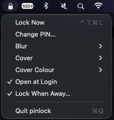
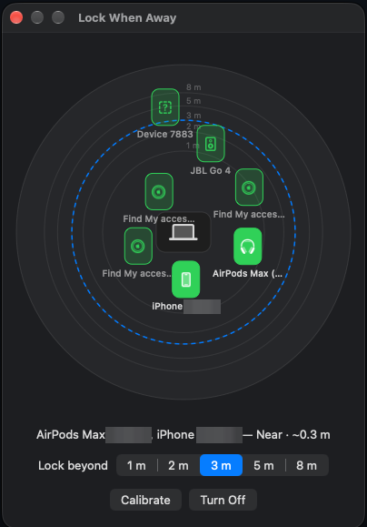

# pinlock

Menu bar kiosk lock for macOS. While locked the screen stays awake and visible, but every click and keystroke is swallowed until the PIN is entered.

<p>
  
  &nbsp;
  
</p>

## What it is, and what it isn't

pinlock is **not** a replacement for the macOS lock screen and does not give full protection. Your session stays logged in and every app keeps running. pinlock only puts a window on top that swallows input. Anyone who can force a restart, reach the Mac over the network, or plug in hardware gets around it.

It exists so you don't have to fully lock the Mac every time you step away for a moment, while still making sure nobody can use it during the minutes you're not there. Your session, open apps and whatever is on screen stay exactly as you left them. When you leave the Mac for longer, or somewhere you don't trust, lock it properly with **⌃⌘Q**.

## Build

```sh
make            # builds pinlock.app
make install    # signs it, copies it to /Applications and launches it
make uninstall
```

The first `make install` creates a self-signed code-signing certificate called **pinlock dev** in your login keychain. macOS may ask once whether `codesign` can use it: enter your password and choose **Always Allow**. The certificate gives pinlock the same identity on every build. Without it, each rebuild looks like a new app to macOS and silently loses the permissions below. To get rid of it later, delete **pinlock dev** in Keychain Access.

### Permissions

pinlock only asks for these when you turn on the feature that needs them:

| Permission | Needed for | Asked when |
| --- | --- | --- |
| Bluetooth | Lock When Away | you open Lock When Away… |
| Motion & Fitness | Blur When Looking Away (head tracking) | you pick a turn angle |
| Screen Recording | the blur of Blur When Looking Away | you pick a turn angle. Relaunch pinlock after allowing it |

If a feature acts as if a permission is missing even though System Settings shows it on, remove pinlock from that list in **System Settings → Privacy & Security**, then relaunch pinlock and allow it again.

## Usage

- Set a PIN on first launch (at least 4 digits). Change it from the menu bar item.
- Lock with **⌃⌥⌘L** or **Lock Now** in the menu.
- Blur, cover strength and cover colour are configurable from the menu.
- Forgot the PIN? Click **Use Mac Password** on the lock screen and enter your macOS account password.
- **Lock When Away…** opens a radar: your Mac in the middle and nearby Bluetooth devices placed by estimated distance, each with an icon for what it is (iPhone, Watch, AirPods, speaker, …). Click the devices you carry to watch them. Any one of them nearby counts as you being there. Pick a distance (1–8 m, the dashed ring), and pinlock locks once every watched device has stayed beyond it for 15 seconds.
- Distances come from signal strength, which a pocket or your body weakens a lot. Click **Calibrate** while sitting as usual, with your phone wherever you keep it, and distances are measured from there. Treat them as rough: Bluetooth can't measure real distance, so expect about ±1–2 m.
- **Blur When Looking Away** (macOS 14+): with head-tracking AirPods or Beats on (AirPods Pro, Max, AirPods 3rd gen and later), turning your head away from the screen blurs it the way the iPhone Duo does when it folds: the blur starts at the side you turned to, sharp on the far side and stronger towards your side, then spreads until the whole screen is evenly blurred and slightly darkened. Looking back clears it the same way. The blur needs Screen Recording access (pinlock asks when you turn the feature on). Without it the screen only darkens. The snapshot it blurs stays in memory and is dropped as soon as you look back.

## If you're locked out

pinlock is just a process, so nothing it does survives that process ending. In order of preference:

1. **Wait about 10 seconds.** If pinlock freezes while locked, a watchdog quits it, which removes the lock. A crash removes it too.
2. **Use Mac Password** on the lock screen if you forgot the PIN.
3. **SSH in from another machine** (needs Remote Login enabled) and run `pkill pinlock`. The lock disappears and nothing is lost.
4. **Hold the power button** (Touch ID button on Apple Silicon) for about 10 seconds to force the Mac off, then turn it on again. This always works, but unsaved work is lost. Keyboard restart shortcuts may be blocked while locked.

After a restart, pinlock never locks on its own. Even with Open at Login it starts unlocked, and Lock When Away only arms after it has seen your phone nearby. The macOS login screen asks for your Mac password, not the PIN.

Try it safely first — this locks immediately and unlocks after 10 seconds:

```sh
./pinlock.app/Contents/MacOS/pinlock 10
```

Check the watchdog — this locks, freezes, and should disappear after about 12 seconds:

```sh
./pinlock.app/Contents/MacOS/pinlock --hangtest
```

Preview the look-away blur, no headphones needed. Launching through `open` makes it use pinlock's own Screen Recording permission, not your terminal's:

```sh
open -n pinlock.app --args --peektest
```

Run the self-test with `./pinlock.app/Contents/MacOS/pinlock --selftest`.
